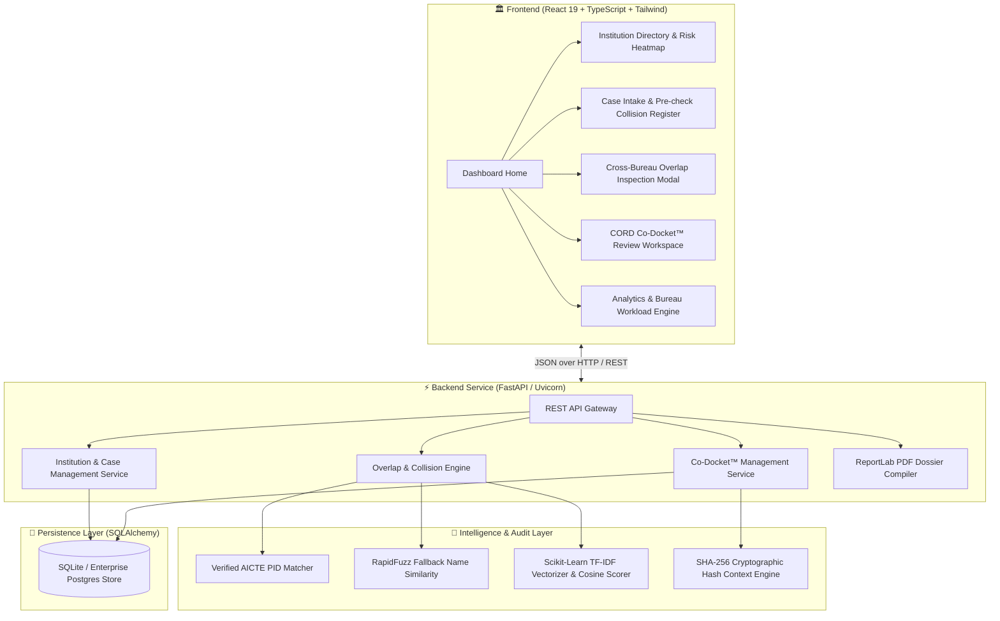

# 🏛️ CORD: Cross-Bureau Overlap & Redressal Dashboard

<div align="center">


<br/>

**"Integrated Dashboard for Monitoring and Tracking Institution-Related Complaint Cases Across AICTE Bureaus/Cells"**

*A Next-Generation GovTech Coordination Platform designed to eradicate regulatory blind spots across autonomous AICTE bureaus without destructive auto-merges or black-box automated decisions.*

[Key Innovations](#-7-govtech-core-principles) • [Architecture](#-system-architecture) • [Golden Demo Journey](#-the-3-minute-golden-demo-journey) • [Quick Start](#-quick-start-guide) • [Verification & Testing](#-automated-testing--qa)

</div>

---

## 📌 Executive Summary & Problem Context

The **All India Council for Technical Education (AICTE)** operates across multiple autonomous regulatory bureaus and cells:
* **PGRC** (Public Grievance Redressal Cell — student/faculty grievances, fee disputes)
* **Approval Bureau** (Sanctioned seat matrices, land compliance, faculty norms)
* **Regulation Bureau** (Affiliation norms, unauthorized seat expansions, curriculum compliance)
* **Legal Cell** (High Court/Supreme Court litigation, contempt notices, stay orders)
* **Vigilance Cell** (Financial fraud, ghost faculty probes)
* **Regional Offices (ROs)** (Ground inspections, demarcation disputes)

### 🚨 The Critical Challenge
Complaints and infractions involving the same technical institution are frequently filed across different bureaus under completely separate dockets. 
* **The Regulatory Blind Spot:** A college facing student fee extortion complaints in PGRC may concurrently be under review for an unauthorized 60-seat expansion in the Regulation Bureau, while petitioning the High Court for interim relief in Legal Cell.
* **The Failure of Naive IT Systems:** Generic grievance portals either fail to detect connections across bureaus or commit **destructive auto-merging** — combining separate complaints into a single record. This violates statutory jurisdiction, destroys audit integrity, and treats completely distinct issues (e.g. fee dispute vs boundary wall demarcation) as "duplicates".

### 💡 CORD's Solution
CORD introduces **Coordinated Intelligence with Zero Destructive Merges**:
1. Autonomous bureaus keep 100% ownership, unique case IDs, and statutory workflows.
2. An explainable NLP similarity engine signals related infractions in real-time.
3. Officers collaborate via **CORD Co-Docket™ workspaces** backed by **immutable SHA-256 cryptographic context receipts** and court-ready PDF dossiers.

---

## 🏛️ 7 GovTech Core Principles

```
  ┌────────────────────────────────────────────────────────────────────────┐
  │                           CORD GOVTECH SUITE                           │
  ├────────────────────────────┬───────────────────────────────────────────┤
  │ 1. Institution ≠ Issue     │ Multiple complaints on 1 PID are NEVER    │
  │    Identity                │ blindly merged or discarded as duplicates │
  ├────────────────────────────┼───────────────────────────────────────────┤
  │ 2. Verified PID Primary    │ AICTE Permanent Institute ID is anchor;   │
  │    Anchor                  │ RapidFuzz flags unverified fallback names │
  ├────────────────────────────┼───────────────────────────────────────────┤
  │ 3. 100% Explainable NLP    │ TF-IDF cosine similarity + tokens; zero   │
  │    Signals                 │ black-box hallucination risk              │
  ├────────────────────────────┼───────────────────────────────────────────┤
  │ 4. Zero Destructive        │ Bureaus retain full autonomy, original    │
  │    Auto-Merges             │ IDs, and independent status transitions   │
  ├────────────────────────────┼───────────────────────────────────────────┤
  │ 5. Regulators Retain       │ CORD provides intelligence; human bureau  │
  │    Statutory Authority     │ officials make all binding decisions      │
  ├────────────────────────────┼───────────────────────────────────────────┤
  │ 6. Cryptographic           │ SHA-256 hashed audit snapshot of reviewed │
  │    Context Receipts™       │ cases, timestamp, and official remarks    │
  ├────────────────────────────┼───────────────────────────────────────────┤
  │ 7. ReportLab Co-Docket     │ Authoritative, multi-page PDF dossiers    │
  │    Dossier Engine          │ compiled on-demand for inter-cell review  │
  └────────────────────────────┴───────────────────────────────────────────┘
```

---

## 🏗️ System Architecture



---

## 🌟 Key Functional Modules

### 1. 🔍 Cross-Bureau Overlap Inspection Modal
* Transparently displays the exact **mathematical overlap score** (e.g. 84% Overlap).
* Breaks down **matching rationale** by highlighted terms (e.g., *Fees / Admissions*, *Faculty Deficit*, *Seat Expansion*).
* Shows side-by-side bureau jurisdiction (e.g., PGRC vs Regulation Bureau).

### 2. 🛡️ Real-Time Pre-Submission Collision Register
* When a bureau officer enters a new complaint, CORD runs a live collision check against active cases before docketing.
* Prevents parallel, uncoordinated investigation cycles across regional or national desks.

### 3. 📑 CORD Co-Docket™ Collaborative Workspace
* Allows officers from different bureaus to assemble linked cases into a consolidated **Co-Docket**.
* Records official regulatory assessment notes with reviewer designation.
* Generates an **immutable SHA-256 Context Receipt** with a tamper-evident cryptographic hash signature.

### 4. 🖨️ Automated PDF Review Dossier (ReportLab)
* Compiles court-ready, multi-page formal PDF dossiers containing:
  * Official AICTE crest & header
  * Co-Docket metadata & bureau breakdown
  * Side-by-side case logs & evidence timeline
  * Cryptographic verification signature block & QR verification placeholder

### 5. 📊 Real-Time Analytics & Bureau Workload
* Visualizes active caseload distribution across all 6 AICTE bureaus/cells.
* Institutional risk heatmap categorizing institutions into High/Medium/Low overlap urgency.

---

## 🧭 The 3-Minute Golden Demo Journey

For hackathon evaluators and jury members to experience the complete workflow:

1. **Dashboard Overview (`http://127.0.0.1:5173`)**:
   * Observe the authentic Indian GovTech aesthetic (Warm Cream `#FEFCDF`, Burgundy `#7D2932`, Deep Navy `#0B2545`) adhering to MeitY/AICTE design guidelines.
2. **Flagship Test Institution (`DEMO-PID-104`)**:
   * Open **Demo Institute North**.
   * Observe `DEMO-PGRC-104` (Student fee complaint, PGRC) and `DEMO-RB-219` (Unapproved 60-seat expansion, Regulation Bureau) highlighted with an active overlap signal.
   * Observe `DEMO-RO-302` (Campus boundary wall dispute) listed under the same college but marked as **Disposed & Unrelated** *(demonstrating Principle 1: Institution Identity ≠ Issue Identity)*.
3. **Inspect Overlap Evidence**:
   * Click **"Inspect Overlap Evidence"** to view explainable TF-IDF keyword weights (84% overlap on *Fees, Admissions, Faculty*).
4. **Coordinate via Co-Docket™**:
   * Click **"Confirm Related for Coordination"** and open the **Co-Docket Workspace**.
5. **Issue Context Receipt**:
   * Enter a review note (e.g., *"Joint hearing recommended between PGRC and Regulation Bureau prior to approval renewal"*).
   * Click **"Save Review Note & Record Receipt"** to view the instant SHA-256 cryptographic snapshot and timestamp.
6. **Download Dossier**:
   * Click **"Download Co-Docket PDF"** to inspect the authoritative multi-page ReportLab regulatory dossier.

---

## 🚀 Quick Start Guide

### Prerequisites
* **Python**: 3.10+ (Recommended: 3.12 or 3.14)
* **Node.js**: 18+ and `npm`

### 1. Clone the Repository
```bash
git clone https://github.com/hxxshx/SIH2026_CORD.git
cd SIH2026_CORD
```

### 2. Backend Setup & Launch (FastAPI)
```bash
# In the project root:
# Install dependencies (if not already installed in your Python environment)
pip install fastapi uvicorn sqlalchemy pydantic scikit-learn rapidfuzz reportlab pytest httpx

# Start the API server
python -m uvicorn backend.app.main:app --host 127.0.0.1 --port 8000
```
* **API Documentation (Swagger UI)**: `http://127.0.0.1:8000/docs`
* **API Health Check**: `http://127.0.0.1:8000/`

### 3. Frontend Setup & Launch (React + Vite)
```bash
# In a new terminal window:
cd frontend
npm install
npm run dev -- --host 127.0.0.1 --port 5173
```
* **Web Portal**: `http://127.0.0.1:5173`

---

## 🧪 Automated Testing & QA

CORD includes an automated test suite verifying overlap detection accuracy, API lifecycle, and PDF compilation:

```bash
cd backend
python -m pytest tests -v
```

### Test Suite Coverage:
* `test_overlap.py`: Tests deterministic PID matching, RapidFuzz threshold fallbacks, and TF-IDF cosine similarity calculations.
* `test_codocket.py`: Verifies Co-Docket assembly, review note storage, SHA-256 context receipt hashing, and ReportLab PDF compilation.
* `test_api.py`: Validates FastAPI REST endpoints for institutions, complaints, overlaps, and Co-Dockets.

```
============================== 8 passed in 0.82s ===============================
```

---

## 🛠️ Technology Stack

| Layer | Technologies |
|---|---|
| **Frontend** | React 19, TypeScript, Vite, Tailwind CSS, Lucide Icons |
| **Backend API** | FastAPI (Async), Uvicorn, Pydantic v2 |
| **Database & ORM** | SQLite / SQLAlchemy |
| **NLP & Matching** | Scikit-Learn (TF-IDF Vectorizer, Cosine Similarity), RapidFuzz |
| **Document Generation** | ReportLab (Custom GovTech PDF Generation Engine) |
| **Security & Integrity** | Python `hashlib` (SHA-256 Context Receipts) |
| **Testing** | Pytest, HTTPX TestClient |

---

## 👥 Smart India Hackathon 2026 Submission

* **Problem Statement ID**: 26264
* **Problem Title**: Integrated Dashboard for Monitoring and Tracking Institution-Related Complaint Cases Across AICTE Bureaus/Cells
* **Ministry / Department**: All India Council for Technical Education (AICTE), Ministry of Education
* **Category**: Software
* **Repository**: [https://github.com/hxxshx/SIH2026_CORD](https://github.com/hxxshx/SIH2026_CORD)

---

<div align="center">
  <sub>Built with precision for the Government of India & All India Council for Technical Education · SIH 2026</sub>
</div>
